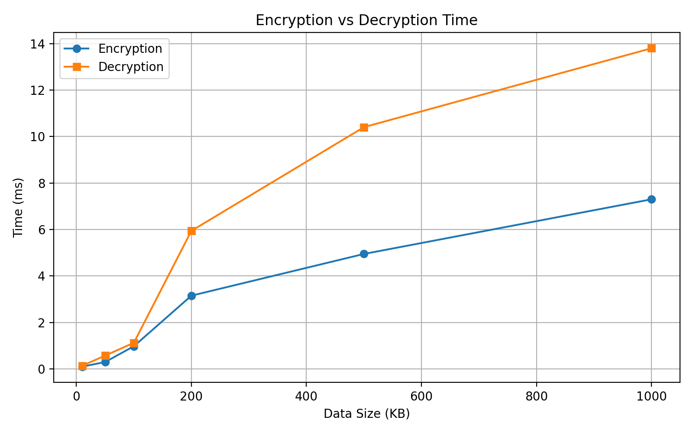
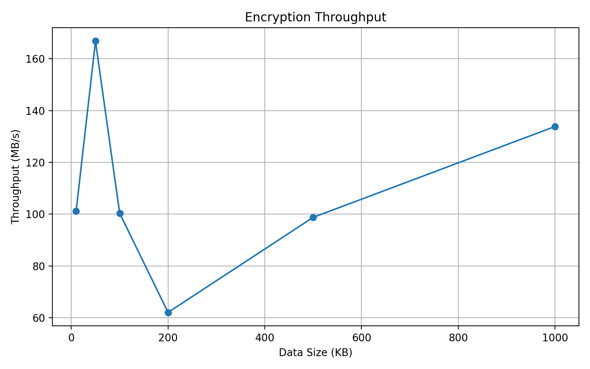
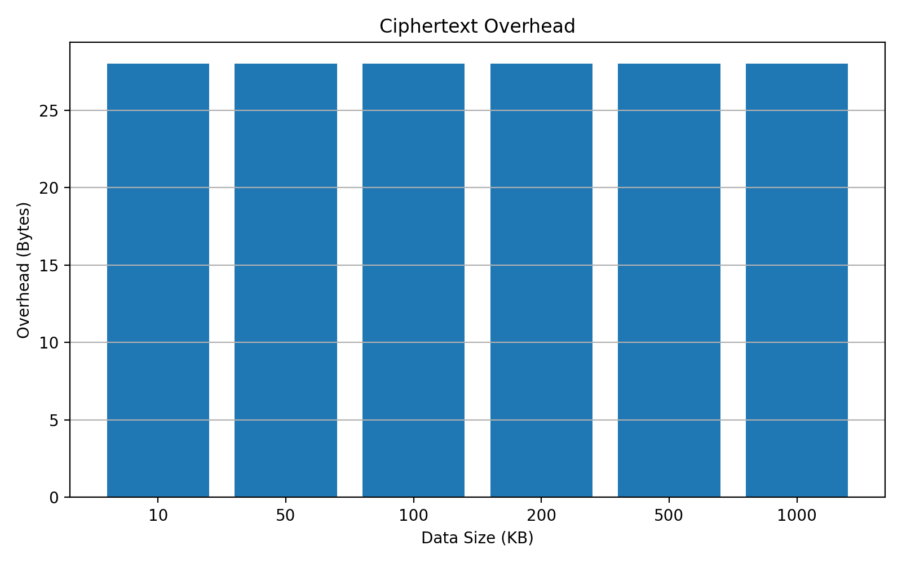

# DCCF – Dynamic Cryptographic Confidentiality Framework

## Project Overview

DCCF (Dynamic Cryptographic Confidentiality Framework) is a Python-based academic project designed to improve data confidentiality in multi-tenant cloud environments using dynamic cryptographic techniques.

The framework demonstrates how sensitive data can be protected using encryption, tenant-specific keys, key rotation, and controlled cross-tenant data sharing.

## Key Features

- **AES-128-GCM Encryption:** Provides data confidentiality and integrity.
- **Multi-Tenant Isolation:** Maintains separate encryption keys for different tenants.
- **Dynamic Key Rotation:** Supports updating tenant encryption keys while retaining access to previously encrypted data.
- **Secure Data Sharing:** Demonstrates controlled sharing between tenants through decryption and re-encryption.
- **Tampering Detection:** Detects unauthorized modifications to encrypted data through authenticated encryption.
- **Performance Evaluation:** Measures encryption time, decryption time, throughput, and ciphertext overhead.
- **Streamlit Interface:** Provides a simple interface to demonstrate the framework.

## Technologies Used

- Python
- AES-128-GCM
- Cryptography Library
- Streamlit
- Google Colab
- Pandas
- Matplotlib
- Unittest

## System Workflow

1. Create tenants and generate tenant-specific encryption keys.
2. Encrypt data using AES-128-GCM.
3. Store encrypted data with the corresponding tenant information.
4. Decrypt data using the appropriate tenant key.
5. Perform key rotation when required.
6. Demonstrate controlled data sharing between tenants.
7. Evaluate encryption and decryption performance.

## Performance Evaluation

The framework evaluates cryptographic performance using programmatically generated test data of different sizes.

The evaluation includes:

- Encryption and decryption time
- Encryption throughput
- Ciphertext overhead

### 1. Encryption and Decryption Time



### 2. Encryption Throughput



### 3. Ciphertext Overhead



The detailed benchmark results are available in:

`results/performance_results.csv`

## Installation and Execution

### 1. Clone the Repository

```bash
git clone https://github.com/vivekvaali/dynamic-cryptographic-confidentiality-framework.git
```

### 2. Navigate to the Project Directory

```bash
cd dynamic-cryptographic-confidentiality-framework
```

### 3. Install Dependencies

```bash
pip install -r requirements.txt
```

### 4. Run the Application

```bash
streamlit run app.py
```

**Note:** The application may require configuration of the key-storage directory when running outside Google Colab. Do not upload actual encryption keys to GitHub.

## Automated Testing

The project includes automated tests using Python's `unittest` framework.

Run the tests using:

```bash
python -m unittest discover -s tests -v
```

## Repository Structure

```text
dynamic-cryptographic-confidentiality-framework/
│
├── notebooks/
│   └── DCCF_Final_Project.ipynb
│
├── results/
│   ├── performance_results.csv
│   └── charts/
│       ├── ciphertext_overhead.png
│       ├── encryption_decryption_time.png
│       └── encryption_throughput.png
│
├── tests/
│   └── test_dccf.py
│
├── app.py
├── dccf_framework.py
├── requirements.txt
├── .gitignore
└── README.md
```

## Security Considerations

- Each tenant uses a separate encryption key.
- AES-GCM provides authenticated encryption.
- Encryption keys and sensitive environment files are excluded from version control through `.gitignore`.
- Cross-tenant data sharing is demonstrated using decryption and re-encryption.
- For production deployment, secure key management should be implemented using a dedicated Key Management Service (KMS) or Hardware Security Module (HSM).

## Project Limitations

This project is an academic demonstration and is not intended to be used as a production-ready cloud security system. Further work would be required for production deployment, including secure key management, access control, auditing, and scalable cloud integration.

## Conclusion

DCCF demonstrates how dynamic cryptographic techniques can support data confidentiality in multi-tenant environments. The project combines authenticated encryption, tenant isolation, key rotation, controlled data sharing, and performance evaluation in a Python-based framework.
